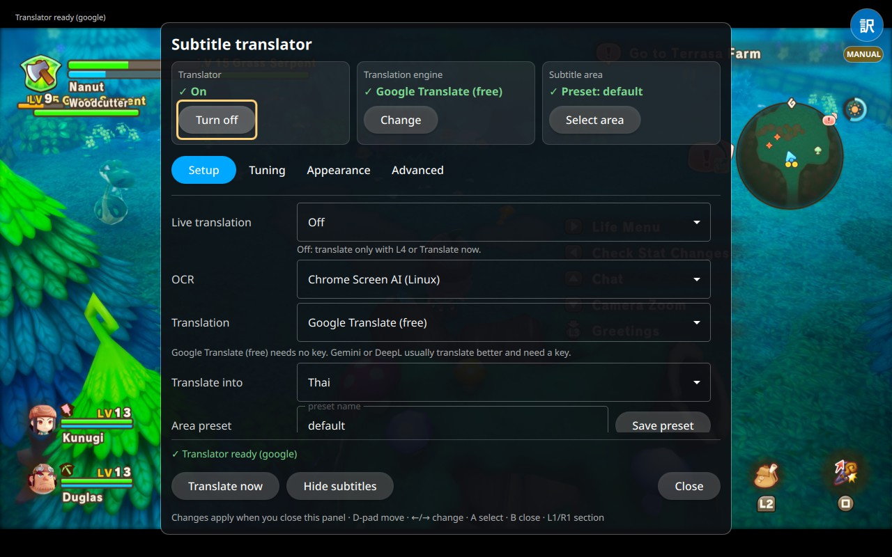

+++
title = 'chiaki-ngx'
description = 'PlayStation Remote Play でゲームの字幕を翻訳したい？ chiaki-ngx は複数の OCR エンジンに対応し、タイ語または英語で翻訳を表示します。'
date = '2026-11-25T00:00:00+07:00'
layout = 'project'

[params]
seo_title = 'PlayStation Remote Play の OCR と翻訳 | chiaki-ngx'
eyebrow = 'PlayStation Remote Play クライアント'
tagline = '複数の OCR エンジンで画面上のゲームの文字を読み取り、タイ語または英語に翻訳します。'
card_pitch = 'ゲームの字幕を翻訳したい？ OCR エンジンと、タイ語/英語の出力を選べます。'
route_from = 'PS4 / PS5'
route_to = 'Steam Deck / デスクトップ'
hero_alt = 'PlayStation Remote Play のオーバーレイに、タイ語に翻訳されたゲームの会話を表示している chiaki-ngx。'
hero_caption = 'Remote Play 中にタイ語へ翻訳されたゲームの会話。'
requirements = [
  'Remote Play 用の PlayStation 4 または PlayStation 5',
  '動作確認済みの AppImage 版には、Steam Deck または Linux x86_64',
  '翻訳は任意です。デフォルトの Google Translate プロバイダーは API キー不要です',
]
steps = [
  'GitHub Releases から最新の **Steam Deck / Linux AppImage** をダウンロードします。',
  '[Steam Deck セットアップガイド](https://github.com/kidpeterpan/chiaki-ngx/blob/main/docs/translator/STEAMDECK.md)に従ってインストールし、Steam に追加します。',
  'Remote Play のストリームを開始し、Translator パネルを開いて、字幕を翻訳したい場合はオンにします。',
]

[params.cta]
label = 'Steam Deck 版をダウンロード'

[params.cta_secondary]
label = 'Steam Deck セットアップガイドを読む'

[[params.faq]]
q = '翻訳なしでも chiaki-ngx は使えますか？'
a = '''
はい。翻訳機能は任意で、デフォルトではオフです。アプリは Remote Play クライアントとしてそのまま使えます。
'''

[[params.faq]]
q = '翻訳には API キーが必要ですか？'
a = '''
いいえ。Google Translate は無料のデフォルトで、API キーは不要です。ほかのクラウドプロバイダーはキーが必要な場合があり、オフラインの NLLB には別のビルドとモデルが必要です。
'''

[[params.faq]]
q = 'chiaki-ngx はどの言語に対応していますか？'
a = '''
アプリ内で選べる出力言語はタイ語と英語です。Google の [ChromeOS ML OCR のドキュメント](https://developers.google.com/chromeos/app-development/news/frictionless-pdf-accessibility-with-ml-and-ocr)には、上流の OCR 機能が 77 言語に対応すると書かれていますが、chiaki-ngx はゲーム映像で 77 言語すべてを検証してはいません。対応する元言語はプロバイダーによって異なります。
'''

[[params.faq]]
q = 'どこでダウンロードできますか？'
a = '''
動作確認済みのリリースは、Steam Deck と Linux x86_64 向けの AppImage です。macOS はソースからビルドします。[macOS ガイド](https://github.com/kidpeterpan/chiaki-ngx/blob/main/docs/translator/MACOS.md)をご覧ください。
'''
+++

## ストリームして翻訳

chiaki-ngx は、オープンソースの PlayStation 4/5 Remote Play クライアント Chiaki-ng のフォークです。任意で使える翻訳機能は、複数の OCR プロバイダーで画面上のゲームの文字を読み取り、タイ語または英語の翻訳を表示できます。対応する元言語は、選んだ OCR プロバイダーによって異なります。翻訳機能はデフォルトでオフなので、Remote Play だけのクライアントとしても使えます。

## 追加される機能

- **複数の OCR エンジン。** PaddleOCR、RapidOCR、Google Cloud Vision、OCR.space、Gemini Vision、または Linux 上の Chrome Screen AI から選べます。対応する元言語はプロバイダーによって異なります。
- **タイ語または英語への翻訳。** Google Translate は無料で、デフォルトですぐ使えます。Gemini、DeepL、Google Cloud Translation、OpenAI 互換サービス、オフラインの NLLB にも対応しています。
- **文脈と辞書の検索。** 直近の会話の文脈、翻訳キャッシュ、オフラインの JMdict 辞書によって、セリフが読みやすくなり、単語も調べられます。
- **Steam Deck の操作。** コントローラーでの操作、タッチ、キー割り当てを変更できるホットキー、ビューポート内の翻訳オーバーレイを使えます。

AppImage をインストールする前に [Steam Deck セットアップガイド](https://github.com/kidpeterpan/chiaki-ngx/blob/main/docs/translator/STEAMDECK.md)を読むか、[macOS ビルドガイド](https://github.com/kidpeterpan/chiaki-ngx/blob/main/docs/translator/MACOS.md)をご覧ください。
