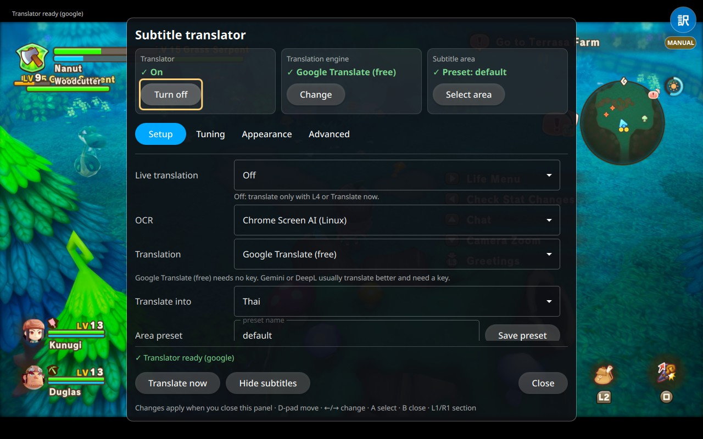

+++
title = 'chiaki-ngx'
description = 'PlayStation Remote Play에서 게임 자막을 번역하고 싶으신가요? chiaki-ngx는 여러 OCR 엔진을 제공하며 태국어 또는 영어로 번역해 보여 줍니다.'
date = '2026-11-25T00:00:00+07:00'
layout = 'project'

[params]
seo_title = 'PlayStation Remote Play OCR 및 번역 | chiaki-ngx'
eyebrow = 'PlayStation Remote Play 클라이언트'
tagline = '여러 OCR 엔진으로 화면 속 게임 텍스트를 읽고, 태국어 또는 영어로 번역합니다.'
card_pitch = '게임 자막을 번역하고 싶으신가요? OCR 엔진과 태국어/영어 출력을 고르세요.'
route_from = 'PS4 / PS5'
route_to = 'Steam Deck / 데스크톱'
hero_alt = 'PlayStation Remote Play 오버레이에 태국어로 번역된 게임 대화를 보여 주는 chiaki-ngx.'
hero_caption = 'Remote Play 중 태국어로 번역된 게임 대화.'
requirements = [
  'Remote Play용 PlayStation 4 또는 PlayStation 5',
  '검증된 AppImage 릴리스를 위한 Steam Deck 또는 Linux x86_64',
  '번역은 선택 사항입니다. 기본 Google Translate 제공자는 API 키가 필요 없습니다',
]
steps = [
  'GitHub Releases에서 최신 **Steam Deck / Linux AppImage**를 내려받습니다.',
  '[Steam Deck 설정 가이드](https://github.com/kidpeterpan/chiaki-ngx/blob/main/docs/translator/STEAMDECK.md)를 따라 설치하고 Steam에 추가합니다.',
  'Remote Play 스트림을 시작하고 Translator 패널을 연 다음, 자막을 번역하고 싶다면 켭니다.',
]

[params.cta]
label = 'Steam Deck용 다운로드'

[params.cta_secondary]
label = 'Steam Deck 설정 가이드 읽기'

[[params.faq]]
q = '번역 없이도 chiaki-ngx를 쓸 수 있나요?'
a = '''
네. 번역 기능은 선택 사항이며 기본적으로 꺼져 있습니다. 앱은 그대로 Remote Play 클라이언트로 작동합니다.
'''

[[params.faq]]
q = '번역에 API 키가 필요한가요?'
a = '''
아니요. Google Translate는 무료 기본값이며 API 키가 필요 없습니다. 다른 클라우드 제공자는 키가 필요할 수 있고, 오프라인 NLLB는 별도의 빌드와 모델이 필요합니다.
'''

[[params.faq]]
q = 'chiaki-ngx는 어떤 언어를 지원하나요?'
a = '''
앱 안에서 고를 수 있는 출력 언어는 태국어와 영어입니다. Google의 [ChromeOS ML OCR 문서](https://developers.google.com/chromeos/app-development/news/frictionless-pdf-accessibility-with-ml-and-ocr)는 상위 OCR 기능이 77개 언어를 지원한다고 적고 있지만, chiaki-ngx는 게임 영상으로 77개 언어를 모두 검증하지는 않았습니다. 지원되는 원본 언어는 제공자마다 다릅니다.
'''

[[params.faq]]
q = '어디서 내려받을 수 있나요?'
a = '''
검증된 릴리스는 Steam Deck과 Linux x86_64용 AppImage입니다. macOS는 소스에서 빌드해야 합니다. [macOS 가이드](https://github.com/kidpeterpan/chiaki-ngx/blob/main/docs/translator/MACOS.md)를 참고하세요.
'''
+++

## 스트리밍하고 번역하기

chiaki-ngx는 오픈 소스 PlayStation 4/5 Remote Play 클라이언트인 Chiaki-ng의 포크입니다. 선택 사항인 번역 기능은 여러 OCR 제공자로 화면 속 게임 텍스트를 읽고, 태국어 또는 영어 번역을 표시할 수 있습니다. 지원되는 원본 언어는 선택한 OCR 제공자에 따라 다릅니다. 번역 기능은 기본적으로 꺼져 있으므로, Remote Play만 하는 클라이언트로도 쓸 수 있습니다.

## 추가된 기능

- **여러 OCR 엔진.** PaddleOCR, RapidOCR, Google Cloud Vision, OCR.space, Gemini Vision, 또는 Linux의 Chrome Screen AI 중에서 고를 수 있습니다. 지원되는 원본 언어는 제공자마다 다릅니다.
- **태국어 또는 영어 번역.** Google Translate는 무료이며 기본으로 바로 작동합니다. Gemini, DeepL, Google Cloud Translation, OpenAI 호환 서비스, 오프라인 NLLB도 지원합니다.
- **문맥과 사전 검색.** 이어지는 대화 문맥, 번역 캐시, 오프라인 JMdict 사전이 대사를 읽기 쉽게 유지해 주고 단어도 찾아볼 수 있게 해 줍니다.
- **Steam Deck 조작.** 컨트롤러 탐색, 터치, 다시 지정할 수 있는 단축키, 뷰포트 안의 번역 오버레이를 사용할 수 있습니다.

AppImage를 설치하기 전에 [Steam Deck 설정 가이드](https://github.com/kidpeterpan/chiaki-ngx/blob/main/docs/translator/STEAMDECK.md)를 읽거나, [macOS 빌드 가이드](https://github.com/kidpeterpan/chiaki-ngx/blob/main/docs/translator/MACOS.md)를 참고하세요.
