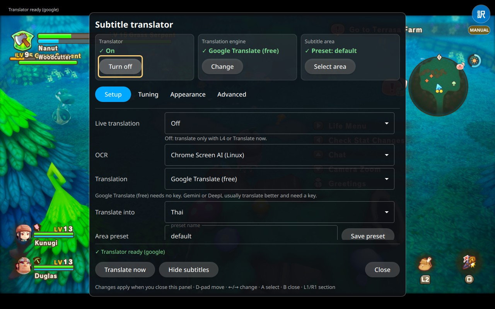

+++
title = 'chiaki-ngx'
description = 'Need game subtitles translated in PlayStation Remote Play? chiaki-ngx offers multiple OCR engines and Thai or English output.'
date = '2026-11-25T00:00:00+07:00'
layout = 'project'
images = ['translator-overlay-thai.jpg']

[params]
order = 3
seo_title = 'PlayStation Remote Play OCR & Translation | chiaki-ngx'
eyebrow = 'PlayStation Remote Play client'
tagline = 'Read on-screen game text with multiple OCR engines; translate it into Thai or English.'
card_pitch = 'Need game subtitles translated? Choose an OCR engine and Thai/English output.'
route_from = 'PS4 / PS5'
route_to = 'Steam Deck / Desktop'
hero_image = 'translator-overlay-thai.jpg'
hero_alt = 'Chiaki-ngx showing game dialogue translated into Thai in the PlayStation Remote Play overlay.'
hero_caption = 'Game dialogue translated into Thai during Remote Play.'
version = '0.1.0-translator'
repo_url = 'https://github.com/kidpeterpan/chiaki-ngx'
license = 'AGPL-3.0-only-OpenSSL'
license_url = 'https://github.com/kidpeterpan/chiaki-ngx/blob/main/COPYING'
os = 'Steam Deck and Linux x86_64 AppImage; macOS build from source'
category = 'GameApplication'
cta_kind = 'download'
requirements = [
  'A PlayStation 4 or PlayStation 5 for Remote Play',
  'Steam Deck or Linux x86_64 for the verified AppImage release',
  'Translation is optional; the default Google Translate provider needs no API key',
]
steps = [
  'Download the latest **Steam Deck / Linux AppImage** from GitHub Releases.',
  'Follow the [Steam Deck setup guide](https://github.com/kidpeterpan/chiaki-ngx/blob/main/docs/translator/STEAMDECK.md) to install it and add it to Steam.',
  'Start a Remote Play stream, open the Translator panel, and turn it on if you want subtitles translated.',
]

[params.cta]
label = 'Download for Steam Deck'
url = 'https://github.com/kidpeterpan/chiaki-ngx/releases/latest'

[params.cta_secondary]
label = 'Read the Steam Deck setup guide'
url = 'https://github.com/kidpeterpan/chiaki-ngx/blob/main/docs/translator/STEAMDECK.md'

[[params.faq]]
q = 'Does chiaki-ngx work without translation?'
a = '''
Yes. The translator is optional and disabled by default; the app still works as a Remote Play client.
'''

[[params.faq]]
q = 'Does translation need an API key?'
a = '''
No. Google Translate is the free default and needs no API key. Other cloud providers may need a key, and offline NLLB needs a separate build and model.
'''

[[params.faq]]
q = 'Which languages does chiaki-ngx support?'
a = '''
The in-app output choices are Thai and English. Google's [ChromeOS ML OCR documentation](https://developers.google.com/chromeos/app-development/news/frictionless-pdf-accessibility-with-ml-and-ocr) lists 77 languages for its upstream OCR feature, but chiaki-ngx has not validated all 77 on game footage; source coverage varies by provider.
'''

[[params.faq]]
q = 'Where can I download it?'
a = '''
The verified release is an AppImage for Steam Deck and Linux x86_64. macOS builds from source; see the [macOS guide](https://github.com/kidpeterpan/chiaki-ngx/blob/main/docs/translator/MACOS.md).
'''
+++

## Stream and translate

chiaki-ngx is a fork of Chiaki-ng, the open-source PlayStation 4/5 Remote Play client. Its optional translator reads on-screen game text with multiple OCR providers and can display Thai or English translations. Source-language coverage depends on the selected OCR provider. It is disabled by default, so the client can also be used for Remote Play alone.

## What it adds

- **Multiple OCR engines.** Choose from PaddleOCR, RapidOCR, Google Cloud Vision, OCR.space, Gemini Vision, or Chrome Screen AI on Linux; source-language coverage varies by provider.
- **Thai or English translations.** Google Translate is free and works by default; Gemini, DeepL, Google Cloud Translation, OpenAI-compatible services, and offline NLLB are also supported.
- **Context and dictionary lookup.** Rolling dialogue context, a translation cache, and the offline JMdict dictionary help keep lines readable and let you look up words.
- **Steam Deck controls.** Use controller navigation, touch, remappable hotkeys, and an in-viewport translation overlay.

Read the [Steam Deck setup guide](https://github.com/kidpeterpan/chiaki-ngx/blob/main/docs/translator/STEAMDECK.md) before installing the AppImage, or see the [macOS build guide](https://github.com/kidpeterpan/chiaki-ngx/blob/main/docs/translator/MACOS.md).
