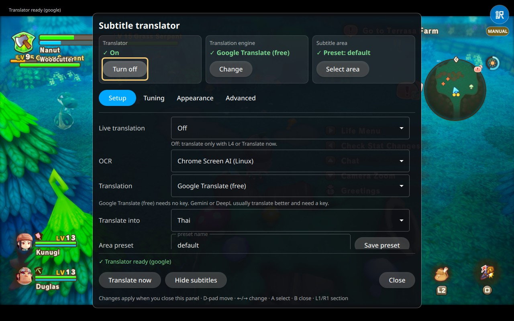

+++
title = 'chiaki-ngx'
description = 'ต้องการแปลซับไตเติลเกมใน PlayStation Remote Play? chiaki-ngx มี OCR หลายเอนจิน และแปลเป็นไทยหรืออังกฤษได้'
date = '2026-11-25T00:00:00+07:00'
layout = 'project'

[params]
seo_title = 'OCR และแปลภาษาใน PlayStation Remote Play | chiaki-ngx'
eyebrow = 'ไคลเอนต์ PlayStation Remote Play'
tagline = 'อ่านข้อความบนหน้าจอเกมด้วย OCR หลายเอนจิน แล้วแปลเป็นไทยหรืออังกฤษ'
card_pitch = 'อยากแปลซับไตเติลเกม? เลือกเอนจิน OCR และภาษาที่จะแสดงได้เลย'
route_from = 'PS4 / PS5'
route_to = 'Steam Deck / เดสก์ท็อป'
hero_alt = 'chiaki-ngx แสดงบทสนทนาในเกมที่แปลเป็นภาษาไทยบน overlay ของ PlayStation Remote Play'
hero_caption = 'บทสนทนาในเกมที่แปลเป็นไทยระหว่างใช้ Remote Play'
requirements = [
  'PlayStation 4 หรือ PlayStation 5 สำหรับ Remote Play',
  'Steam Deck หรือ Linux x86_64 สำหรับ AppImage รุ่นที่ทดสอบแล้ว',
  'การแปลเป็นทางเลือก ตัวแปลค่าเริ่มต้น Google Translate ไม่ต้องใช้ API key',
]
steps = [
  'ดาวน์โหลด **Steam Deck / Linux AppImage** ล่าสุดจาก GitHub Releases',
  'ทำตาม[คู่มือติดตั้งบน Steam Deck](https://github.com/kidpeterpan/chiaki-ngx/blob/main/docs/translator/STEAMDECK.md) เพื่อติดตั้งและเพิ่มลงใน Steam',
  'เริ่มสตรีม Remote Play เปิดแผง Translator แล้วเปิดใช้งานหากต้องการให้แปลซับไตเติล',
]

[params.cta]
label = 'ดาวน์โหลดสำหรับ Steam Deck'

[params.cta_secondary]
label = 'อ่านคู่มือติดตั้งบน Steam Deck'

[[params.faq]]
q = 'chiaki-ngx ใช้ได้โดยไม่เปิดการแปลไหม?'
a = '''
ได้ ตัวแปลเป็นทางเลือกและปิดอยู่เป็นค่าเริ่มต้น แอปยังทำงานเป็นไคลเอนต์ Remote Play ได้ตามปกติ
'''

[[params.faq]]
q = 'การแปลต้องใช้ API key ไหม?'
a = '''
ไม่ต้อง Google Translate เป็นค่าเริ่มต้นที่ฟรีและไม่ต้องใช้ API key ผู้ให้บริการคลาวด์รายอื่นอาจต้องใช้ key และ NLLB แบบออฟไลน์ต้องใช้บิลด์และโมเดลแยกต่างหาก
'''

[[params.faq]]
q = 'chiaki-ngx รองรับภาษาอะไรบ้าง?'
a = '''
ตัวเลือกภาษาที่แสดงในแอปคือไทยและอังกฤษ [เอกสาร ChromeOS ML OCR](https://developers.google.com/chromeos/app-development/news/frictionless-pdf-accessibility-with-ml-and-ocr) ของ Google ระบุว่า OCR ต้นทางรองรับ 77 ภาษา แต่ chiaki-ngx ยังไม่ได้ตรวจสอบครบทั้ง 77 ภาษากับภาพจากเกมจริง ภาษาต้นทางที่รองรับขึ้นกับผู้ให้บริการแต่ละราย
'''

[[params.faq]]
q = 'ดาวน์โหลดได้จากที่ไหน?'
a = '''
รุ่นที่ทดสอบแล้วเป็น AppImage สำหรับ Steam Deck และ Linux x86_64 ส่วน macOS ต้องสร้างจากซอร์สโค้ด ดู[คู่มือ macOS](https://github.com/kidpeterpan/chiaki-ngx/blob/main/docs/translator/MACOS.md)
'''
+++

## สตรีมและแปล

chiaki-ngx เป็นฟอร์กของ Chiaki-ng ไคลเอนต์ Remote Play ของ PlayStation 4/5 แบบโอเพนซอร์ส ตัวแปลที่เป็นทางเลือกอ่านข้อความบนหน้าจอเกมด้วยผู้ให้บริการ OCR หลายราย และแสดงคำแปลเป็นไทยหรืออังกฤษได้ ภาษาต้นทางที่รองรับขึ้นกับผู้ให้บริการ OCR ที่เลือก ตัวแปลปิดอยู่เป็นค่าเริ่มต้น จึงใช้เป็นไคลเอนต์ Remote Play อย่างเดียวก็ได้

## สิ่งที่เพิ่มเข้ามา

- **OCR หลายเอนจิน** เลือกได้จาก PaddleOCR, RapidOCR, Google Cloud Vision, OCR.space, Gemini Vision หรือ Chrome Screen AI บน Linux ภาษาต้นทางที่รองรับขึ้นกับผู้ให้บริการ
- **แปลเป็นไทยหรืออังกฤษ** Google Translate ฟรีและใช้ได้ทันที นอกจากนี้ยังรองรับ Gemini, DeepL, Google Cloud Translation, บริการที่เข้ากันได้กับ OpenAI และ NLLB แบบออฟไลน์
- **บริบทและการค้นคำศัพท์** บริบทบทสนทนาต่อเนื่อง แคชคำแปล และพจนานุกรม JMdict แบบออฟไลน์ ช่วยให้อ่านบรรทัดได้ลื่นและค้นคำได้
- **ควบคุมบน Steam Deck** ใช้การนำทางด้วยคอนโทรลเลอร์ การสัมผัส ปุ่มลัดที่กำหนดเองได้ และ overlay คำแปลในวิวพอร์ต

อ่าน[คู่มือติดตั้งบน Steam Deck](https://github.com/kidpeterpan/chiaki-ngx/blob/main/docs/translator/STEAMDECK.md)ก่อนติดตั้ง AppImage หรือดู[คู่มือสร้างบน macOS](https://github.com/kidpeterpan/chiaki-ngx/blob/main/docs/translator/MACOS.md)
