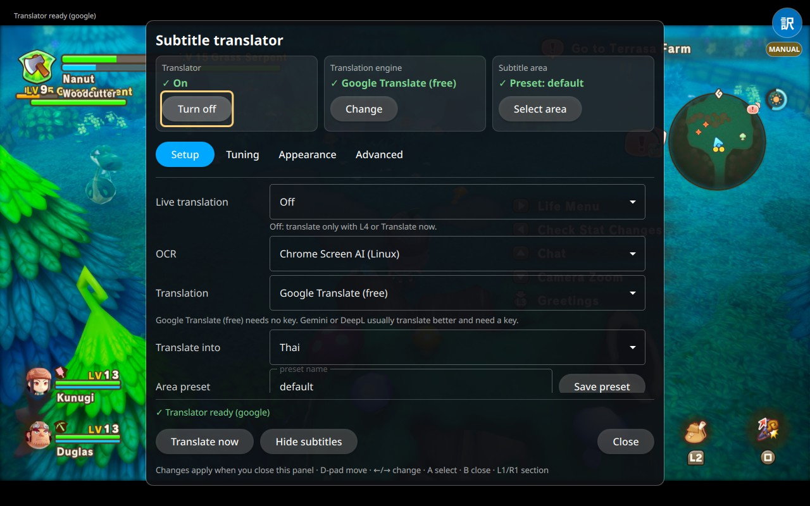

+++
title = 'chiaki-ngx'
description = '想在 PlayStation Remote Play 里翻译游戏字幕？chiaki-ngx 提供多种 OCR 引擎，可输出泰语或英语翻译。'
date = '2026-11-25T00:00:00+07:00'
layout = 'project'

[params]
seo_title = 'PlayStation Remote Play 的 OCR 与翻译 | chiaki-ngx'
eyebrow = 'PlayStation Remote Play 客户端'
tagline = '用多种 OCR 引擎读取屏幕上的游戏文字，并翻译成泰语或英语。'
card_pitch = '想翻译游戏字幕？选一个 OCR 引擎，再选泰语或英语输出。'
route_from = 'PS4 / PS5'
route_to = 'Steam Deck / 桌面电脑'
hero_alt = 'chiaki-ngx 在 PlayStation Remote Play 的叠加层中显示翻译成泰语的游戏对话。'
hero_caption = 'Remote Play 时翻译成泰语的游戏对话。'
requirements = [
  '用于 Remote Play 的 PlayStation 4 或 PlayStation 5',
  'Steam Deck 或 Linux x86_64，用于已验证的 AppImage 版本',
  '翻译是可选的；默认的 Google Translate 提供方不需要 API key',
]
steps = [
  '从 GitHub Releases 下载最新的 **Steam Deck / Linux AppImage**。',
  '按照 [Steam Deck 安装指南](https://github.com/kidpeterpan/chiaki-ngx/blob/main/docs/translator/STEAMDECK.md)安装，并把它添加到 Steam。',
  '开始 Remote Play 串流，打开 Translator 面板；如果想翻译字幕，就把它打开。',
]

[params.cta]
label = '下载 Steam Deck 版'

[params.cta_secondary]
label = '阅读 Steam Deck 安装指南'

[[params.faq]]
q = '不用翻译，chiaki-ngx 还能用吗？'
a = '''
可以。翻译功能是可选的，默认关闭；应用仍然可以作为 Remote Play 客户端使用。
'''

[[params.faq]]
q = '翻译需要 API key 吗？'
a = '''
不需要。Google Translate 是免费的默认选项，不需要 API key。其他云服务提供方可能需要 key，离线 NLLB 则需要单独的构建和模型。
'''

[[params.faq]]
q = 'chiaki-ngx 支持哪些语言？'
a = '''
应用内可选的输出语言是泰语和英语。Google 的 [ChromeOS ML OCR 文档](https://developers.google.com/chromeos/app-development/news/frictionless-pdf-accessibility-with-ml-and-ocr)称其上游 OCR 功能支持 77 种语言，但 chiaki-ngx 并没有用游戏画面验证全部 77 种；支持的源语言因提供方而异。
'''

[[params.faq]]
q = '在哪里下载？'
a = '''
已验证的版本是面向 Steam Deck 和 Linux x86_64 的 AppImage。macOS 需要从源码构建，请参阅 [macOS 指南](https://github.com/kidpeterpan/chiaki-ngx/blob/main/docs/translator/MACOS.md)。
'''
+++

## 串流并翻译

chiaki-ngx 是 Chiaki-ng 的分支，后者是开源的 PlayStation 4/5 Remote Play 客户端。它可选的翻译功能会用多个 OCR 提供方读取屏幕上的游戏文字，并可以显示泰语或英语翻译。支持的源语言取决于所选的 OCR 提供方。翻译功能默认关闭，所以也可以只把它当作 Remote Play 客户端使用。

## 它增加了什么

- **多种 OCR 引擎。** 可选 PaddleOCR、RapidOCR、Google Cloud Vision、OCR.space、Gemini Vision，或 Linux 上的 Chrome Screen AI；支持的源语言因提供方而异。
- **泰语或英语翻译。** Google Translate 免费，默认即可使用；同时也支持 Gemini、DeepL、Google Cloud Translation、兼容 OpenAI 的服务以及离线 NLLB。
- **上下文和词典查询。** 滚动保留的对话上下文、翻译缓存，以及离线的 JMdict 词典，帮助保持台词可读，也让你可以查词。
- **Steam Deck 操控。** 支持手柄导航、触控、可重新映射的快捷键，以及显示在画面内的翻译叠加层。

安装 AppImage 之前，请先阅读 [Steam Deck 安装指南](https://github.com/kidpeterpan/chiaki-ngx/blob/main/docs/translator/STEAMDECK.md)，或查看 [macOS 构建指南](https://github.com/kidpeterpan/chiaki-ngx/blob/main/docs/translator/MACOS.md)。
