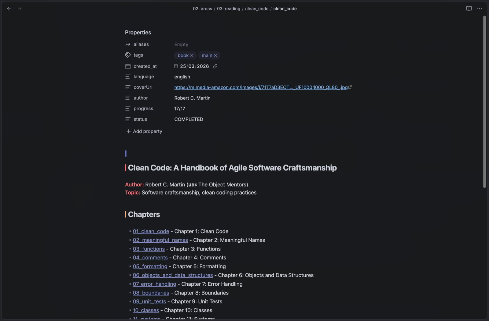
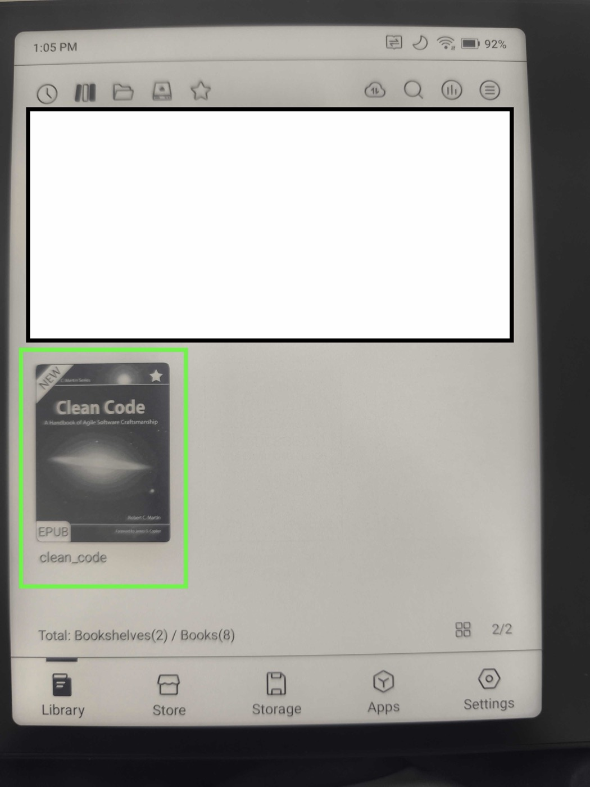
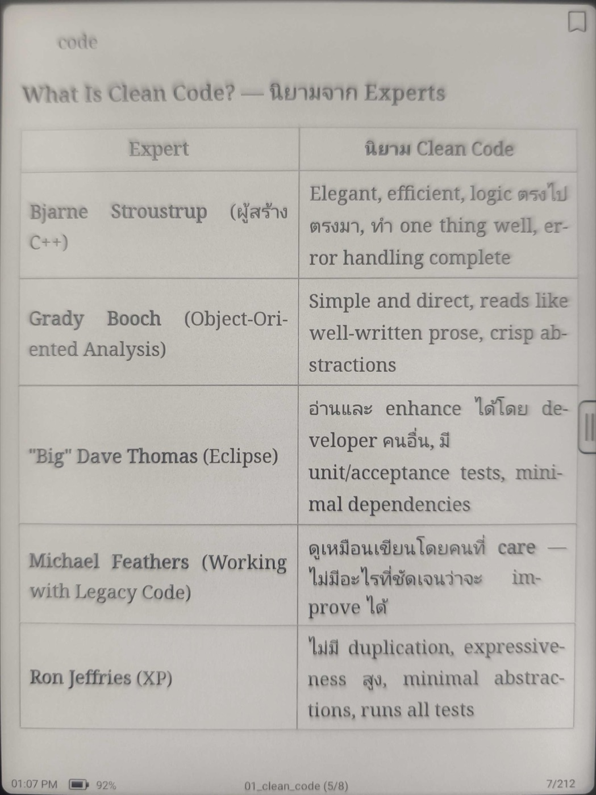

+++
title = 'Inkbound'
description = 'Obsidian のノートを電子ペーパー端末で読もう。Inkbound は、ノート、フォルダ、リンクされたノートを EPUB の本として書き出す、無料の Obsidian プラグインです。'
date = '2026-10-19T00:00:00+07:00'
layout = 'project'

[params]
seo_title = 'Obsidian のノートを電子書籍リーダー向けの EPUB に書き出し | Inkbound'
eyebrow = 'Obsidian プラグイン'
tagline = 'Obsidian のノートを EPUB の本に変えて、ノート PC の画面ではなく電子ペーパー端末で読みましょう。'
card_pitch = '明るい画面で長いノートを読むのに疲れましたか？ 本として書き出して、電子書籍リーダーで読みましょう。'
route_from = 'Obsidian のノート'
route_to = '電子書籍リーダー'
hero_alt = 'Obsidian の本のノート（章の一覧つき）と、「Export note + linked notes to EPUB」を選んだファイルメニュー'
requirements = [
  'Obsidian 1.5.0 以降',
  'デスクトップ（Windows、macOS、Linux）とモバイル（iOS、Android）で動作します',
  'EPUB ファイルを開ける電子書籍リーダーまたはアプリ',
]
steps = [
  'Obsidian で **Settings → Community plugins → Browse**（設定 → コミュニティプラグイン → 閲覧）を開きます。',
  '**Inkbound** を検索して、**Install** をクリックします。',
  '**Enable** をクリックします。',
  'ノートまたはフォルダを右クリックして、**Export … to EPUB** コマンドを選びます。',
]

[params.cta]
label = 'Obsidian でインストール'

[params.cta_secondary]
label = 'または GitHub から手動でインストール'

[[params.faq]]
q = 'どの電子書籍リーダーで使えますか？'
a = '''
Inkbound は標準的な EPUB 3 ファイルを作るので、EPUB を開けるリーダーや読書アプリなら何でも読めます。Onyx Boox をお持ちの場合は、BooxDrop アプリを使って Wi-Fi 経由で本を直接送ることもできます。設定で **Push after export** をオンにしてください。
'''

[[params.faq]]
q = 'タイ語やほかの言語でも使えますか？'
a = '''
はい、どの言語でも使えます。タイ語を含む本には Noto Sans Thai フォントが埋め込まれるので、タイ語フォントのないリーダーでもタイ語が正しく表示されます。
'''

[[params.faq]]
q = 'スマホでも使えますか？'
a = '''
はい。Inkbound は iOS と Android の Obsidian でも動作します。スマホでは、本は vault の中（デフォルトは `Exports` フォルダ）に保存され、**Share last exported book** で直近に書き出した本をほかのアプリへ送れます。
'''

[[params.faq]]
q = 'パソコンの何に触れますか？'
a = '''
Obsidian を通じてノートと画像を読み取り、書き出しのたびに `.epub` ファイルを 1 つ書き込みます（デフォルトでは `~/Downloads`）。ネットワークを使うのは、あなたが求めたときだけです。URL からカバー画像をダウンロードするとき、または本を Boox に送るときです。テレメトリも、分析も、アカウントもありません。
'''
+++

## 仕組み

### 1. 本をノートとして管理する

1 章につき 1 つのノートと、それらを順番にリンクする目次ノートを用意します。Inkbound は、目次ノートのプロパティからタイトル、著者、言語、カバー画像を読み取ります。

### 2. 書き出す

ノートまたはそのフォルダを右クリックして、書き出しを選びます。カバー、目次、すべての画像を含む `.epub` ファイルが 1 つできあがります。

### 3. 電子書籍リーダーで読む

ファイルを好きな電子書籍リーダーで開きます。Boox なら **Push after export** をオンにすると、Wi-Fi 経由で本がライブラリに届きます。

## できること

- **3 通りの書き出し**：1 つのノート、ノートのフォルダを 1 冊の本に（サブフォルダは「部」になります）、またはノートとそこからリンクされているすべてのノート。
- **本棚にカバーが並びます。** ノートに `cover:` を設定するか、設定がなければノートの最初の画像を使います。
- **ジャンプできる目次。** 各章の中のセクションまで対応しています。
- **電子ペーパー向けに調整した画像サイズ。** 大きなスクリーンショットや写真は画面に合わせて縮小されるので、本は軽く、ページめくりも速くなります。
- **図や数式を画像として。** Mermaid の図や LaTeX の数式も、描画できないリーダーで表示されます。
- **本物の脚注。** タップして開き、タップして戻れます。
- **書き出す前にプレビュー。** うまく変換できなかったノートは、レポートで知らせます。
- **すべての本を一度に。** **Export all books** でライブラリ全体を一度に更新でき、ノートに `export: false` と書けば、そのノートを本から外せます。

設定と、Inkbound が読み取るノートのプロパティはすべて、[GitHub の完全版 README](https://github.com/kidpeterpan/inkbound#readme) で説明しています。
