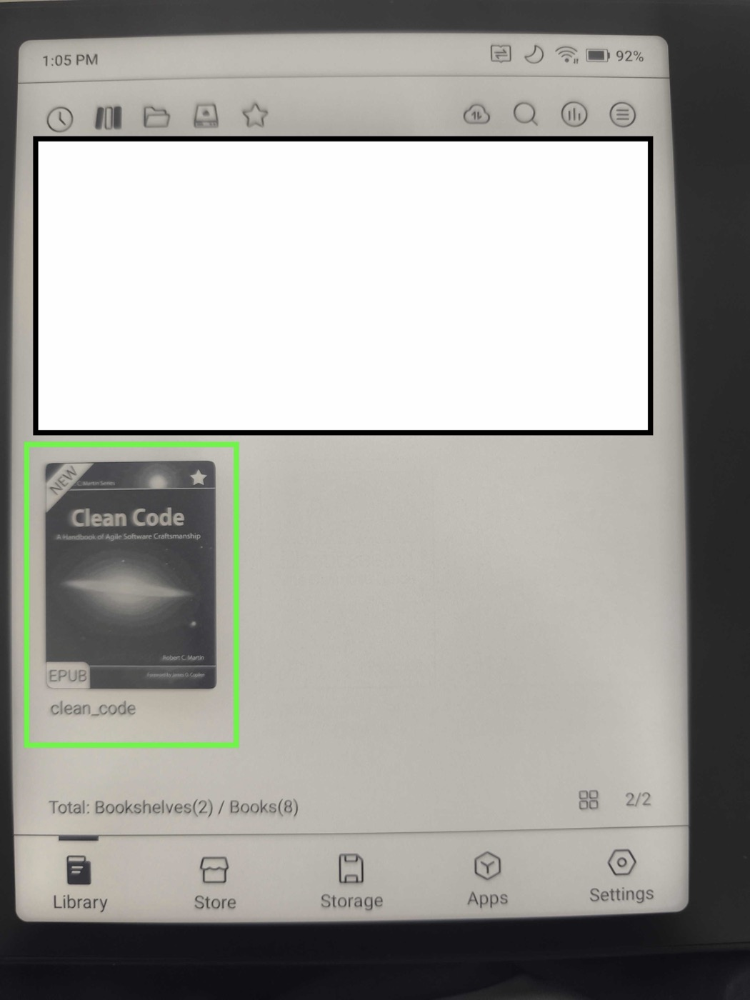
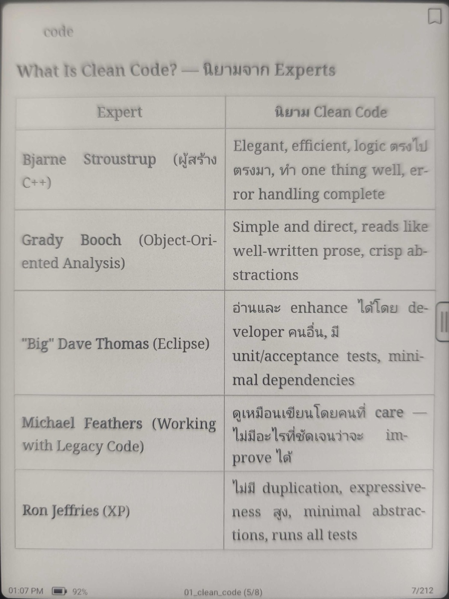

+++
title = 'Inkbound'
description = 'Obsidian 노트를 전자잉크 리더기에서 읽어 보세요. Inkbound는 노트 하나, 폴더, 또는 서로 링크된 노트를 EPUB 책으로 내보내는 무료 Obsidian 플러그인입니다.'
date = '2026-10-19T00:00:00+07:00'
layout = 'project'

[params]
seo_title = 'Obsidian 노트를 전자책 리더기용 EPUB로 내보내기 | Inkbound'
eyebrow = 'Obsidian 플러그인'
tagline = 'Obsidian 노트를 EPUB 책으로 바꿔서 노트북 화면 대신 전자잉크 리더기로 읽으세요.'
card_pitch = '밝은 화면으로 긴 노트를 읽기 지치셨나요? 책으로 내보내서 전자책 리더기에서 읽어 보세요.'
route_from = 'Obsidian 노트'
route_to = '전자책 리더기'
hero_alt = '챕터 목록이 있는 Obsidian 책 노트와, “Export note + linked notes to EPUB” 항목이 열린 파일 메뉴'
requirements = [
  'Obsidian 1.5.0 이상',
  '데스크톱(Windows, macOS, Linux)과 모바일(iOS, Android) 모두에서 작동합니다',
  'EPUB 파일을 열 수 있는 전자책 리더기 또는 앱',
]
steps = [
  'Obsidian에서 **Settings → Community plugins → Browse** (설정 → 커뮤니티 플러그인 → 찾아보기)를 엽니다.',
  '**Inkbound**를 검색한 다음 **Install**을 누릅니다.',
  '**Enable**을 누릅니다.',
  '노트나 폴더를 우클릭하고 **Export … to EPUB** 명령을 선택합니다.',
]

[params.cta]
label = 'Obsidian에서 설치'

[params.cta_secondary]
label = '또는 GitHub에서 직접 설치'

[[params.faq]]
q = '어떤 전자책 리더기에서 쓸 수 있나요?'
a = '''
Inkbound는 표준 EPUB 3 파일을 만들기 때문에, EPUB을 열 수 있는 리더기나 독서 앱이라면 무엇이든 읽을 수 있습니다. Onyx Boox를 쓰신다면 BooxDrop 앱을 통해 Wi-Fi로 책을 바로 보낼 수도 있습니다. 설정에서 **Push after export**를 켜세요.
'''

[[params.faq]]
q = '태국어나 다른 언어도 되나요?'
a = '''
네, 어떤 언어든 됩니다. 태국어가 들어 있는 책에는 Noto Sans Thai 글꼴이 내장되므로, 태국어 글꼴이 없는 리더기에서도 태국어가 제대로 표시됩니다.
'''

[[params.faq]]
q = '휴대폰에서도 쓸 수 있나요?'
a = '''
네. Inkbound는 iOS와 Android의 Obsidian에서도 작동합니다. 휴대폰에서는 책이 vault 안(기본값은 `Exports` 폴더)에 저장되고, **Share last exported book**으로 가장 최근에 내보낸 책을 다른 앱으로 보낼 수 있습니다.
'''

[[params.faq]]
q = '내 컴퓨터의 무엇을 건드리나요?'
a = '''
Obsidian을 통해 노트와 이미지를 읽고, 내보낼 때마다 `.epub` 파일 하나를 씁니다(기본값은 `~/Downloads`). 네트워크는 사용자가 요청할 때만 씁니다. URL에서 표지를 내려받거나 책을 Boox로 보낼 때입니다. 텔레메트리도, 분석도, 계정도 없습니다.
'''
+++

## 작동 방식

### 1. 책을 노트로 관리하기

챕터마다 노트 하나, 그리고 이들을 순서대로 링크하는 목차 노트 하나를 만듭니다. Inkbound는 목차 노트의 속성에서 제목, 저자, 언어, 표지를 읽습니다.

### 2. 내보내기

노트나 그 폴더를 우클릭하고 내보내기를 선택합니다. 표지, 목차, 모든 이미지가 들어 있는 `.epub` 파일 하나가 만들어집니다.

### 3. 전자책 리더기에서 읽기

아무 전자책 리더기에서나 파일을 엽니다. Boox라면 **Push after export**를 켜세요. 책이 Wi-Fi로 라이브러리에 도착합니다.

## 얻을 수 있는 것

- **세 가지 내보내기 방식**: 노트 하나, 노트 폴더를 책 한 권으로(하위 폴더는 부가 됩니다), 또는 노트와 그 노트가 링크한 모든 노트.
- **책장에 표지가 보입니다.** 노트에 `cover:`를 설정하거나, 설정하지 않으면 Inkbound가 노트의 첫 번째 이미지를 씁니다.
- **바로 이동할 수 있는 목차.** 각 챕터 안의 섹션까지 지원합니다.
- **전자잉크에 맞춘 이미지 크기.** 큰 스크린샷과 사진은 화면에 맞게 줄어들어, 책은 작게 유지되고 페이지는 빠르게 넘어갑니다.
- **다이어그램과 수식을 그림으로.** Mermaid 다이어그램과 LaTeX 수식을 그릴 수 없는 리더기에서도 볼 수 있습니다.
- **진짜 각주.** 눌러서 열고, 다시 눌러서 돌아옵니다.
- **내보내기 전 미리보기.** 제대로 변환되지 않은 노트는 보고서로 알려 줍니다.
- **모든 책을 한 번에.** **Export all books**로 라이브러리 전체를 한 번에 새로 만들 수 있고, 노트에 `export: false`를 쓰면 그 노트는 책에서 빠집니다.

설정과 Inkbound가 읽는 모든 노트 속성은 [GitHub의 전체 README](https://github.com/kidpeterpan/inkbound#readme)에 설명되어 있습니다.
