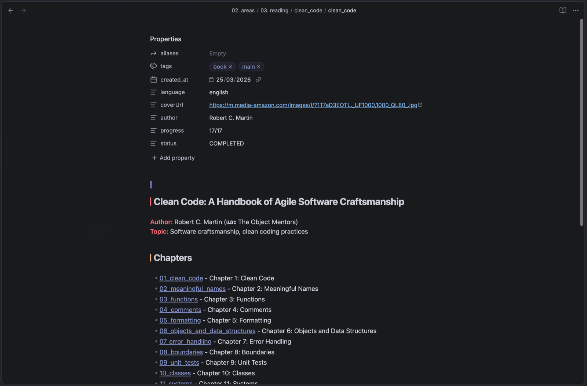
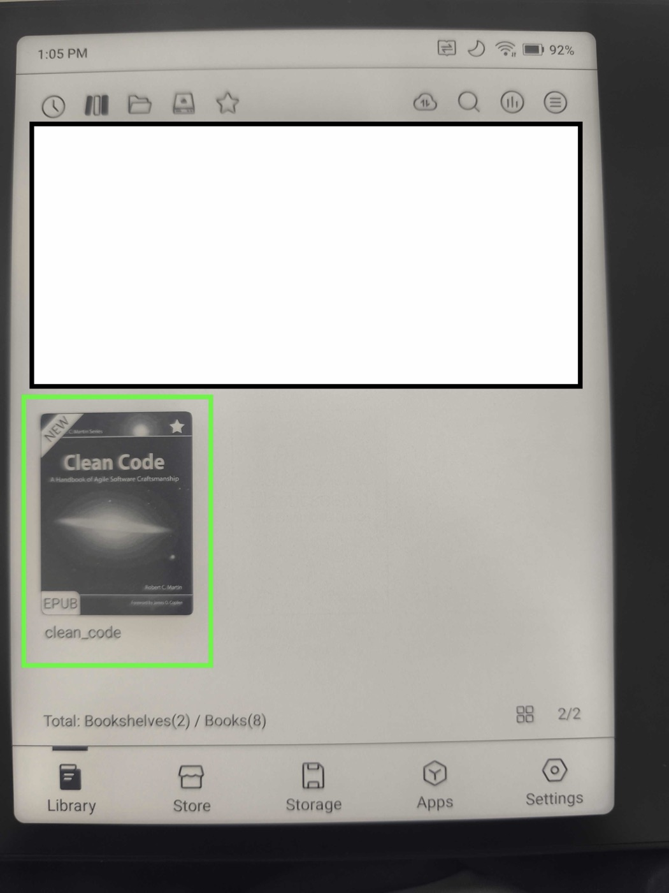
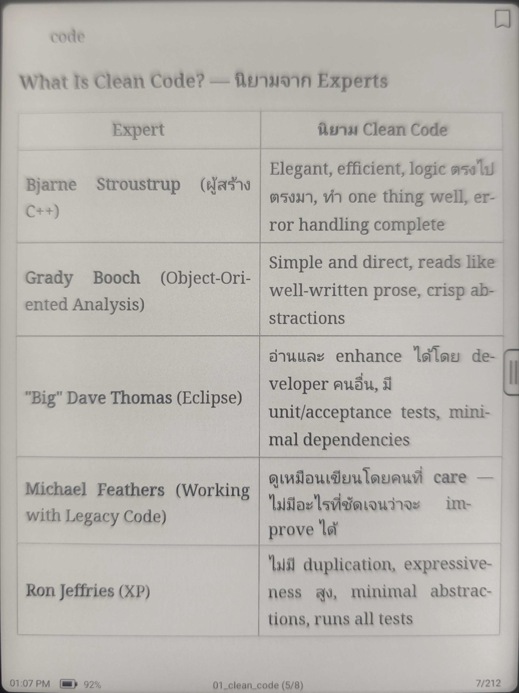

+++
title = 'Inkbound'
description = 'Read your Obsidian notes on an e-ink reader. Inkbound is a free Obsidian plugin that exports a note, a folder or linked notes as an EPUB book.'
date = '2026-10-19T00:00:00+07:00'
layout = 'project'
images = ['export-menu.png']

[params]
order = 2
seo_title = 'Export Obsidian Notes to EPUB for Your E-Reader | Inkbound'
eyebrow = 'Obsidian plugin'
tagline = 'Turn your Obsidian notes into EPUB books, so you can read them on an e-ink reader instead of a laptop screen.'
card_pitch = 'Tired of reading long notes on a bright screen? Export them as a book for your e-reader.'
route_from = 'Obsidian notes'
route_to = 'E-reader'
hero_image = 'export-menu.png'
hero_alt = 'An Obsidian book note with its chapter list, and the file menu open on “Export note + linked notes to EPUB”'
version = '1.15.1'
repo_url = 'https://github.com/kidpeterpan/inkbound'
license = 'MIT'
os = 'Windows, macOS, Linux, iOS, Android (Obsidian 1.5 or newer)'
category = 'ProductivityApplication'
cta_kind = 'install'
requirements = [
  'Obsidian 1.5.0 or newer',
  'Works on desktop (Windows, macOS, Linux) and on mobile (iOS, Android)',
  'Any e-reader or app that opens EPUB files',
]
steps = [
  'In Obsidian, open **Settings → Community plugins → Browse**.',
  'Search for **Inkbound**, then click **Install**.',
  'Click **Enable**.',
  'Right-click a note or a folder and choose an **Export … to EPUB** command.',
]

[params.cta]
label = 'Install in Obsidian'
url = 'https://obsidian.md/plugins?id=inkbound'

[params.cta_secondary]
label = 'Or install it by hand from GitHub'
url = 'https://github.com/kidpeterpan/inkbound/releases/latest'

[[params.faq]]
q = 'Which e-readers does it work with?'
a = '''
Inkbound makes standard EPUB 3 files, so any e-reader or reading app that opens EPUB can read them. If you have an Onyx Boox, Inkbound can also send each book straight to it over Wi-Fi with the BooxDrop app. Turn on **Push after export** in the settings.
'''

[[params.faq]]
q = 'Does it work with Thai and other languages?'
a = '''
Yes, any language works. Books that contain Thai get the Noto Sans Thai font built in, so Thai shows correctly even on readers that have no Thai font.
'''

[[params.faq]]
q = 'Can I use it on my phone?'
a = '''
Yes. Inkbound works in Obsidian on iOS and Android too. On a phone, books are saved inside your vault (in an `Exports` folder by default), and **Share last exported book** sends one to another app.
'''

[[params.faq]]
q = 'What does it touch on my computer?'
a = '''
It reads your notes and images through Obsidian, and writes one `.epub` file per export (to `~/Downloads` by default). It uses the network only when you ask: to download a cover from a URL, or to send a book to your Boox. No telemetry, no analytics, no account.
'''
+++

## How it works

### 1. Keep a book as notes

One note per chapter, and an index note that links them in order. Inkbound reads the title, author, language and cover from the index note’s properties.

### 2. Export it

Right-click the note or its folder and choose an export. You get one `.epub` file with a cover, a table of contents and every image.

### 3. Read it on your e-reader

Open the file on any e-reader. With a Boox, turn on **Push after export** and the book lands in the library over Wi-Fi.

## What you get

- **Three ways to export**: a single note, a folder of notes as a book (subfolders become parts), or a note plus everything it links to.
- **A cover on the shelf.** Set `cover:` in a note, or Inkbound uses the note’s first image.
- **A table of contents you can jump around in**, down to the sections inside each chapter.
- **Images sized for e-ink.** Big screenshots and photos are shrunk to fit the screen, so books stay small and pages turn fast.
- **Diagrams and math as pictures.** Mermaid diagrams and LaTeX math show up on readers that can’t draw them.
- **Real footnotes** you can tap to open and tap to come back from.
- **A preview before you export**, and a report that names any note that didn’t come through cleanly.

Settings and every note property Inkbound reads are explained in the [full README on GitHub](https://github.com/kidpeterpan/inkbound#readme).
