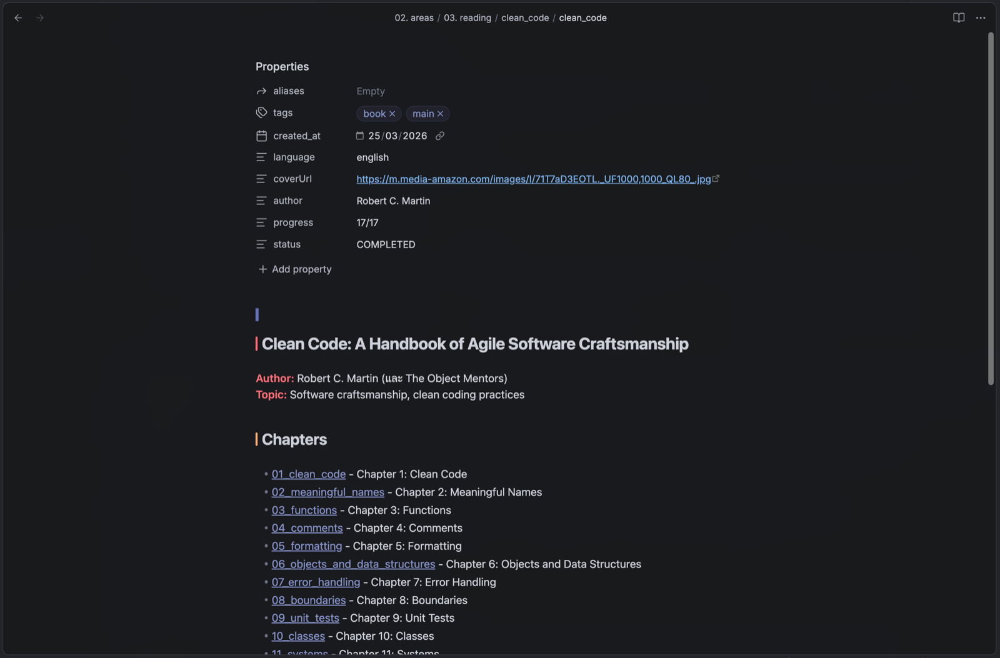
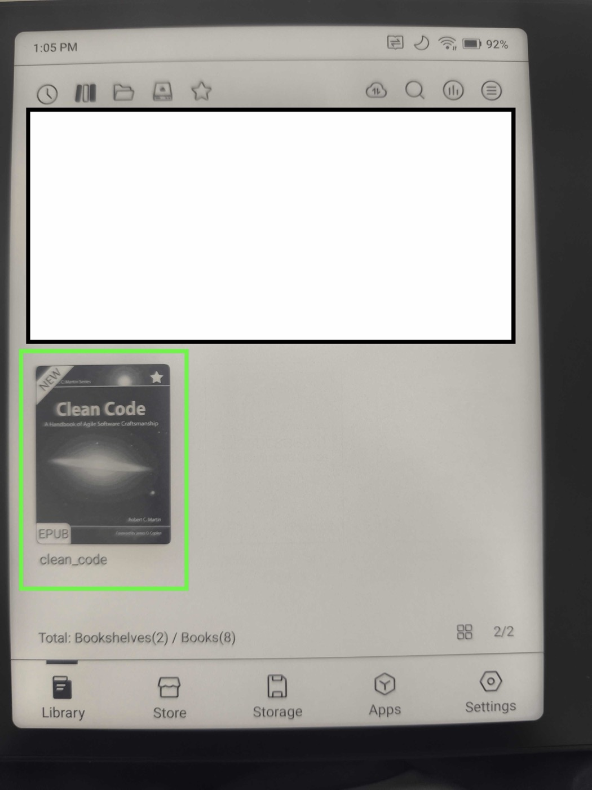
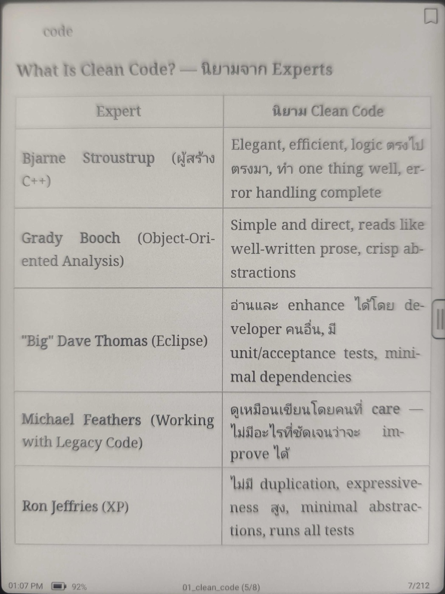

+++
title = 'Inkbound'
description = 'อ่านโน้ต Obsidian บนเครื่องอ่านอีบุ๊กแบบ e-ink Inkbound เป็นปลั๊กอิน Obsidian ฟรีที่ส่งออกโน้ต โฟลเดอร์ หรือโน้ตที่ลิงก์กันเป็นหนังสือ EPUB'
date = '2026-10-19T00:00:00+07:00'
layout = 'project'

[params]
seo_title = 'ส่งออกโน้ต Obsidian เป็น EPUB สำหรับเครื่องอ่านอีบุ๊ก | Inkbound'
eyebrow = 'ปลั๊กอิน Obsidian'
tagline = 'แปลงโน้ต Obsidian เป็นหนังสือ EPUB เพื่อให้อ่านบนเครื่องอ่าน e-ink แทนการจ้องหน้าจอโน้ตบุ๊ก'
card_pitch = 'เบื่อการอ่านโน้ตยาว ๆ บนจอที่สว่างจ้า? ส่งออกเป็นหนังสือไปอ่านบนเครื่องอ่านอีบุ๊กของคุณ'
route_from = 'โน้ต Obsidian'
route_to = 'เครื่องอ่านอีบุ๊ก'
hero_alt = 'โน้ตหนังสือใน Obsidian พร้อมรายการบท และเมนูไฟล์ที่เปิดอยู่ที่ “Export note + linked notes to EPUB”'
requirements = [
  'Obsidian 1.5.0 ขึ้นไป',
  'ใช้ได้บนเดสก์ท็อป (Windows, macOS, Linux) และมือถือ (iOS, Android)',
  'เครื่องอ่านอีบุ๊กหรือแอปใดก็ได้ที่เปิดไฟล์ EPUB ได้',
]
steps = [
  'ใน Obsidian เปิด **Settings → Community plugins → Browse** (การตั้งค่า → ปลั๊กอินจากชุมชน → เรียกดู)',
  'ค้นหา **Inkbound** แล้วคลิก **Install**',
  'คลิก **Enable**',
  'คลิกขวาที่โน้ตหรือโฟลเดอร์ แล้วเลือกคำสั่ง **Export … to EPUB**',
]

[params.cta]
label = 'ติดตั้งใน Obsidian'

[params.cta_secondary]
label = 'หรือติดตั้งเองจาก GitHub'

[[params.faq]]
q = 'ใช้กับเครื่องอ่านอีบุ๊กรุ่นไหนได้บ้าง?'
a = '''
Inkbound สร้างไฟล์ EPUB 3 มาตรฐาน เครื่องอ่านหรือแอปอ่านใดก็ตามที่เปิด EPUB ได้ก็อ่านไฟล์เหล่านี้ได้ ถ้าคุณใช้ Onyx Boox Inkbound ยังส่งหนังสือแต่ละเล่มไปที่เครื่องผ่าน Wi-Fi ด้วยแอป BooxDrop ได้ด้วย เปิด **Push after export** ใน Settings
'''

[[params.faq]]
q = 'รองรับภาษาไทยและภาษาอื่นไหม?'
a = '''
รองรับ ใช้ได้ทุกภาษา หนังสือที่มีภาษาไทยจะฝังฟอนต์ Noto Sans Thai ไว้ในไฟล์ ภาษาไทยจึงแสดงถูกต้องแม้ในเครื่องอ่านที่ไม่มีฟอนต์ไทย
'''

[[params.faq]]
q = 'ใช้บนมือถือได้ไหม?'
a = '''
ได้ Inkbound ใช้ได้ใน Obsidian บน iOS และ Android เช่นกัน บนมือถือ หนังสือจะถูกบันทึกไว้ใน vault ของคุณ (ค่าเริ่มต้นคือโฟลเดอร์ `Exports`) และ **Share last exported book** ส่งเล่มล่าสุดไปยังแอปอื่นได้
'''

[[params.faq]]
q = 'แอปแตะต้องอะไรในคอมพิวเตอร์ของฉันบ้าง?'
a = '''
อ่านโน้ตและรูปภาพของคุณผ่าน Obsidian และเขียนไฟล์ `.epub` หนึ่งไฟล์ต่อการส่งออกหนึ่งครั้ง (ค่าเริ่มต้นไปที่ `~/Downloads`) ใช้เครือข่ายเฉพาะตอนที่คุณสั่งเท่านั้น คือดาวน์โหลดปกจาก URL หรือส่งหนังสือไปที่ Boox ไม่มี telemetry ไม่มี analytics และไม่ต้องมีบัญชี
'''
+++

## ทำงานอย่างไร

### 1. เก็บหนังสือเป็นโน้ต

หนึ่งโน้ตต่อหนึ่งบท และโน้ตสารบัญที่ลิงก์ไปยังแต่ละบทตามลำดับ Inkbound อ่านชื่อเรื่อง ผู้แต่ง ภาษา และปกจากพร็อพเพอร์ตีของโน้ตสารบัญ

### 2. ส่งออก

คลิกขวาที่โน้ตหรือโฟลเดอร์ของมัน แล้วเลือกส่งออก คุณจะได้ไฟล์ `.epub` หนึ่งไฟล์ พร้อมปก สารบัญ และรูปทุกรูป

### 3. อ่านบนเครื่องอ่านอีบุ๊ก

เปิดไฟล์บนเครื่องอ่านเครื่องไหนก็ได้ ถ้าใช้ Boox ให้เปิด **Push after export** แล้วหนังสือจะเข้าห้องสมุดผ่าน Wi-Fi

## ที่คุณจะได้

- **ส่งออกได้สามแบบ**: โน้ตเดียว โฟลเดอร์ของโน้ตเป็นหนังสือ (โฟลเดอร์ย่อยกลายเป็นภาค) หรือโน้ตพร้อมทุกโน้ตที่มันลิงก์ไป
- **มีปกบนชั้น** ตั้ง `cover:` ในโน้ต หรือ Inkbound จะใช้รูปแรกของโน้ต
- **สารบัญที่กดข้ามไปมาได้** ลงไปถึงหัวข้อย่อยในแต่ละบท
- **รูปขนาดพอดีกับ e-ink** ภาพหน้าจอและรูปถ่ายใหญ่ ๆ จะถูกย่อให้พอดีจอ หนังสือจึงไฟล์เล็กและพลิกหน้าเร็ว
- **แผนภาพและสูตรคณิตเป็นรูปภาพ** แผนภาพ Mermaid และสูตร LaTeX ยังแสดงได้บนเครื่องอ่านที่วาดเองไม่ได้
- **เชิงอรรถจริง** แตะเพื่อเปิดและแตะเพื่อกลับมา
- **ดูตัวอย่างก่อนส่งออก** และมีรายงานที่ระบุโน้ตที่แปลงไม่สมบูรณ์
- **ทุกเล่มในครั้งเดียว** **Export all books** รีเฟรชห้องสมุดทั้งหมดในคำสั่งเดียว และ `export: false` ในโน้ตจะกันโน้ตนั้นออกจากหนังสือ

การตั้งค่าและพร็อพเพอร์ตีของโน้ตทุกตัวที่ Inkbound อ่านอธิบายไว้ใน[README ฉบับเต็มบน GitHub](https://github.com/kidpeterpan/inkbound#readme)
