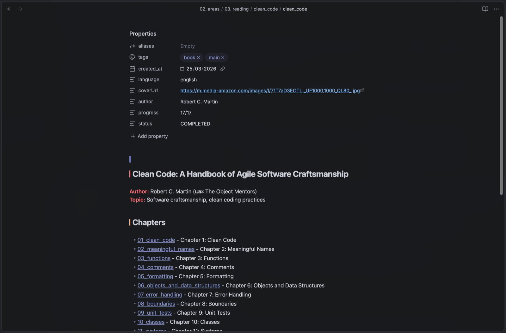
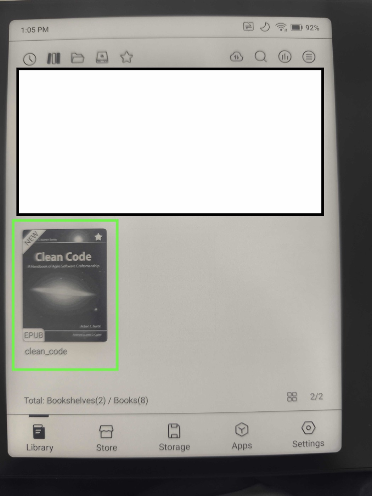
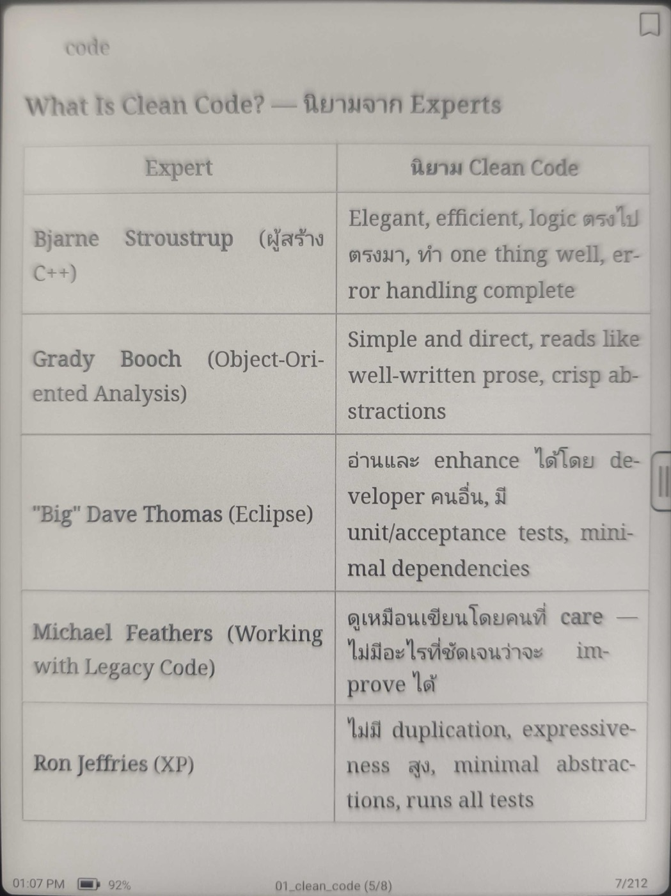

+++
title = 'Inkbound'
description = '在电子墨水阅读器上读你的 Obsidian 笔记。Inkbound 是一款免费的 Obsidian 插件，可以把一篇笔记、一个文件夹或相互链接的笔记导出为 EPUB 图书。'
date = '2026-10-19T00:00:00+07:00'
layout = 'project'

[params]
seo_title = '把 Obsidian 笔记导出为 EPUB，用电子书阅读器阅读 | Inkbound'
eyebrow = 'Obsidian 插件'
tagline = '把 Obsidian 笔记变成 EPUB 图书，这样你就能在电子墨水阅读器上阅读，而不是盯着笔记本电脑屏幕。'
card_pitch = '厌倦了在刺眼的屏幕上读长笔记？把它们导出成书，放到电子书阅读器上读。'
route_from = 'Obsidian 笔记'
route_to = '电子书阅读器'
hero_alt = 'Obsidian 中一篇带章节列表的图书笔记，文件菜单已展开，停在“Export note + linked notes to EPUB”'
requirements = [
  'Obsidian 1.5.0 或更高版本',
  '桌面端（Windows、macOS、Linux）和移动端（iOS、Android）均可使用',
  '任何能打开 EPUB 文件的电子书阅读器或应用',
]
steps = [
  '在 Obsidian 中打开 **Settings → Community plugins → Browse**（设置 → 社区插件 → 浏览）。',
  '搜索 **Inkbound**，然后点击 **Install**。',
  '点击 **Enable**。',
  '右键点击一篇笔记或一个文件夹，选择某个 **Export … to EPUB** 命令。',
]

[params.cta]
label = '在 Obsidian 中安装'

[params.cta_secondary]
label = '或者从 GitHub 手动安装'

[[params.faq]]
q = '它支持哪些电子书阅读器？'
a = '''
Inkbound 生成标准的 EPUB 3 文件，所以任何能打开 EPUB 的阅读器或阅读应用都可以读。如果你有文石 Boox，Inkbound 还可以通过 BooxDrop 应用经 Wi-Fi 把每本书直接发送过去。请在设置中打开 **Push after export**。
'''

[[params.faq]]
q = '支持泰语和其他语言吗？'
a = '''
支持，任何语言都可以。包含泰语的书会内嵌 Noto Sans Thai 字体，所以即使阅读器没有泰语字体，泰语也能正确显示。
'''

[[params.faq]]
q = '能在手机上用吗？'
a = '''
可以。Inkbound 也能在 iOS 和 Android 版的 Obsidian 中使用。在手机上，书会保存在你的 vault 里（默认在 `Exports` 文件夹），并且 **Share last exported book** 可以把最近导出的书发送到其他应用。
'''

[[params.faq]]
q = '它会动我电脑上的什么东西？'
a = '''
它通过 Obsidian 读取你的笔记和图片，每次导出写入一个 `.epub` 文件（默认写到 `~/Downloads`）。只有在你要求时才会使用网络：从 URL 下载封面，或把书发送到你的 Boox。没有遥测，没有分析，也不需要账号。
'''
+++

## 它是怎么工作的

### 1. 把一本书整理成笔记

每章一篇笔记，再加一篇按顺序链接各章的目录笔记。Inkbound 会从目录笔记的属性中读取书名、作者、语言和封面。

### 2. 导出

右键点击这篇笔记或它所在的文件夹，选择一种导出方式。你会得到一个 `.epub` 文件，带有封面、目录和所有图片。

### 3. 在电子书阅读器上阅读

在任何电子书阅读器上打开这个文件。如果用的是 Boox，打开 **Push after export**，书就会经 Wi-Fi 进入书库。

## 你能得到什么

- **三种导出方式**：单篇笔记；把一个文件夹里的笔记导出为一本书（子文件夹会变成“部”）；或者一篇笔记加上它链接到的所有笔记。
- **书架上有封面。** 在笔记里设置 `cover:`，否则 Inkbound 会使用笔记里的第一张图片。
- **可以跳转的目录**，细到每一章里的小节。
- **为电子墨水调整过尺寸的图片。** 大截图和照片会缩小到适合屏幕，所以书保持小巧、翻页很快。
- **把图表和公式变成图片。** 在无法绘制它们的阅读器上，也能看到 Mermaid 图表和 LaTeX 公式。
- **真正的脚注**，点一下打开，再点一下返回。
- **导出前可以预览**，并有一份报告，列出任何没有顺利转换的笔记。
- **一次导出所有书。** **Export all books** 一次性刷新你的整个书库，在笔记上写 `export: false` 可以把它排除在所属的书之外。

设置以及 Inkbound 读取的所有笔记属性，都在 [GitHub 上的完整 README](https://github.com/kidpeterpan/inkbound#readme) 里有说明。
